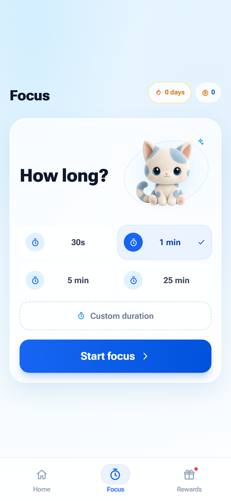

<p align="center">
  
</p>

<h1 align="center">Focus Tracker</h1>

<p align="center"><strong>Set the phone down. Your cat will keep you company.</strong></p>

<p align="center">
  A strict focus timer with a growing pet collection, daily rewards, and a soft sky-blue glass interface.
</p>

<p align="center">
  
  
  
  
</p>

## App preview

<p align="center">
  
</p>

## What it does

Focus Tracker makes putting your phone down part of the focus session. Choose a goal, start the timer, and stay with your pet until the session ends. Touching the screen, leaving or reloading the app, or detected device movement can interrupt a session.

- **Focus sessions:** 30 seconds, 1, 5, or 25 minutes, plus custom sessions from 10 seconds to 4 hours.
- **Twenty-two pets:** Start with the cat and meet new friends through focused minutes, completed sessions, and streak milestones.
- **Coins and rewards:** Earn paw coins from completed sessions, with a weekend bonus. Reach the daily focus goal, collect the daily gift, and claim streak check-ins.
- **Streak protection:** Add one shield before a missed day or repair an eligible streak afterward.
- **Personalization:** Dress pets with accessories like the cozy scarf, bell collar, moon clip, and heart shades; browse 12 curated pet scenes, unlock color themes, and use System, Light, or Dark appearance.
- **Progress:** Review the last seven days of focus, achievements marked with a paw medal, pet unlock goals, and session history.
- **Native touches:** Best-effort haptics, optional evening streak reminders, and status-bar styling on supported devices.

## How a session works

1. Choose a preset or enter a custom duration.
2. Tap **Start focus** and set the phone down.
3. Finish the timer to earn progress and rewards. An interruption ends the attempt; start again when ready.

Rewards and pet milestones are calculated by the game-state layer. The interface reads those same rules for progress, claims, and unlocks.

## Run locally

### Requirements

- Node.js 18.17 or newer
- npm
- Android Studio and the Android SDK to build Android
- macOS and Xcode to build iOS

### Web app

```bash
npm install
npm run dev
```

Open `http://localhost:3000`.

### Checks and production build

```bash
npm test
npm run build
```

`npm test` checks the game rules, migrations, rewards, streaks, shops, and pet progression. The production build exports the web app into `out/`; use `npm run serve` to preview that export.

### Android

```bash
npm install
npm run build
npx cap sync android
npx cap open android
```

Or use `npm run android` to build and launch on a connected Android device or emulator.

### iOS

On macOS with Xcode installed:

```bash
npm install
npm run build
npx cap sync ios
npx cap open ios
```

Configure signing in Xcode before installing or distributing an iOS build.

## Project layout

```text
app/                  Next.js app shell and web manifest
components/           Focus, Home, Rewards, shops, and pet UI
lib/                  Game rules, persistence, and native helpers
public/pets/          Transparent companion artwork
assets/               README preview screenshot
android/              Capacitor Android project
ios/                   Capacitor iOS project
tests/                 Game-state checks and visual review tools
```

## Data and local configuration

There is no account or hosted gameplay backend. Progress is stored on the device, with a Capacitor Preferences backup in native builds. An optional developer-support card can link to Ko-fi on web and Android.

The app does not need runtime environment variables. Keep local signing material and credentials out of version control; never commit API keys, secret files, local agent logs, or generated model downloads.
